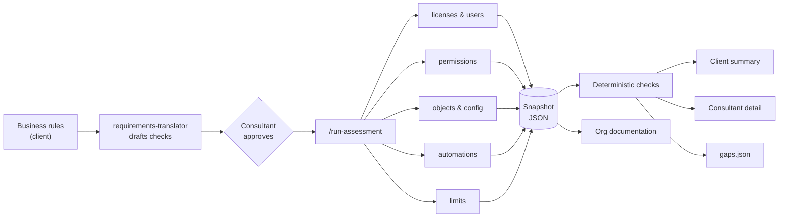

# Org Assessment for Salesforce

**Does this Salesforce org meet what the business asked for?** This project answers that
question automatically, with evidence, and documents the org along the way — without ever
changing it.

A consultant turns the client's business rules into technical checks. Claude Code subagents
then read the org **in parallel**, save a snapshot, and deterministic checks compare the
snapshot with the requirements. The output is a report in business language for the client,
a technical report for the consultant, and a list of gaps that a development pipeline can
pick up next.

Part of the [CSLLABS](https://csllabs.com) portfolio · Salesforce × Claude Code line.

> **Status: early stage.** The guardrails, the collector agents and the requirements format
> are in place. The deterministic checks and the reports are the next steps (see
> [Roadmap](#roadmap)).

## Guardrails

These five rules shape every part of the project. The first one is enforced by code, not by
asking the model nicely.

| # | Guardrail | How it is enforced |
| --- | --- | --- |
| 1 | **Read-only.** The assessment never changes the org. | A `PreToolUse` hook ([`guard_readonly.py`](.claude/hooks/guard_readonly.py)) allows only an allowlist of read-only `sf` commands and blocks everything else, including chained commands, the legacy `sfdx` CLI, HTTP writes and write-like MCP tools. It fails closed. 57 tests cover it. |
| 2 | **Confidentiality between clients.** | `snapshots/` and `reports/` are git-ignored. The second brain stores patterns, never client data. |
| 3 | **The consultant approves.** | Agents draft checks; nothing runs until the requirements file says `status: approved`. |
| 4 | **Code before AI.** | Every check that can be exact is Python code with a reproducible result. AI is used only for judgement calls, and those are labelled. |
| 5 | **Every conclusion has evidence.** | Each result points to the snapshot file and path that proves it. |

## How it works



1. **Requirements** — business rules and their checks in a YAML file
   ([format](requirements/README.md), [example](requirements/example-support-sla.yaml)).
   Every check keeps the id of the rule it came from, so the report can say *"your SLA rule is
   not met because Entitlements are off"* instead of a loose technical list.
2. **Collection** — five subagents, one per area, run the read-only `sf` commands and the
   versioned [SOQL files](queries) in parallel, and save the raw JSON into a timestamped snapshot. Analysis never touches the live org, so
   results are reproducible and before/after runs can be compared.
3. **Analysis** — Python checks read the snapshot and return `met`, `partial` or `not_met`,
   with severity and evidence.
4. **Output** — a client summary, a consultant report and `gaps.json`.
5. **Org documentation** — data dictionary, permission matrix, automation map, licenses and
   limits, plus a methodology appendix, built from the same snapshot.
6. **Second brain** — anonymised patterns from past projects that make the next translation of
   business rules faster.

## What is in this repository

| Path | What it is |
| --- | --- |
| [`CLAUDE.md`](CLAUDE.md) | Instructions Claude Code reads in every session: guardrails, run order, conventions |
| [`.claude/settings.json`](.claude/settings.json) | The read-only hook and a deny list for write commands |
| [`.claude/hooks/guard_readonly.py`](.claude/hooks/guard_readonly.py) | Guardrail 1, in code |
| [`.claude/agents/`](.claude/agents) | Five collector subagents and the requirements translator |
| [`.claude/skills/`](.claude/skills) | `run-assessment` (the `/run-assessment` command) and the read-only collection reference |
| [`queries/`](queries) | The SOQL the collectors run, one query per file |
| [`requirements/`](requirements) | Requirements format and a fictional example |
| [`checks/`](checks) | Deterministic checks *(next step)* |
| [`brain/`](brain) | The second brain: patterns only |
| [`tests/`](tests) | Tests, starting with the guardrail |

## Getting started

Requirements: [Salesforce CLI](https://developer.salesforce.com/tools/salesforcecli) (`sf`),
[Claude Code](https://code.claude.com), Python 3.10+, and a Salesforce org you are allowed to
read (a free Developer Edition org works).

```bash
# 1. Install the test dependencies and check the guardrail
python -m pip install -r requirements-dev.txt
python -m pytest tests

# 2. Connect the org you will assess, with an alias
sf org login web --alias demo

# 3. Open Claude Code in this folder
claude
```

In Claude Code:

1. Ask the `requirements-translator` agent to draft checks for your rules, review them, and set
   `status: approved`.
2. Run `/run-assessment requirements/<your-file>.yaml demo`.

> The hook is started with `python`. If your system only has `python3`, change `command` in
> `.claude/settings.json`.

## Roadmap

- [x] Guardrails, read-only hook and its tests
- [x] Collector subagents, the read-only command reference and the SOQL files
- [x] First full collection on a Developer Edition org: 5 areas in parallel, 16 of 16 commands `ok`
- [ ] One manifest format shared by all collectors (needed by the checks)
- [x] Requirements format (draft) with a fictional example
- [ ] Deterministic checks and `results.json`
- [ ] Reports: client summary, consultant detail, `gaps.json`
- [ ] Org documentation generator
- [ ] Demo: a Developer Edition org with planted problems (too few licenses, excessive
      permissions, legacy automations) and its published report
- [ ] Second brain: pattern format and approval flow
- [ ] Later: hand `gaps.json` to an orchestrated development pipeline and re-run the assessment
      to prove the gaps are closed

## Author

Carlos Silva — Salesforce developer (Platform Developer I, Data Cloud Specialist, AI Specialist).
[csllabs.com](https://csllabs.com) · [GitHub](https://github.com/csilva86)

## License

[MIT](LICENSE)
