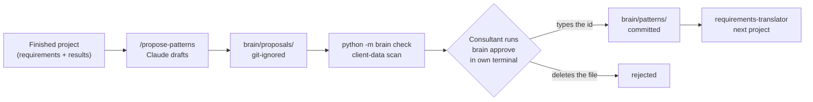

# brain/ — the second brain

What one project teaches, kept for the next one: which checks a kind of business rule needs,
which gaps keep coming back and how they were fixed, what would have saved time. The
`requirements-translator` agent reads the approved patterns before drafting checks.

It keeps **what we learned, never whose org it was**.

| Folder | What is there | In git? |
| --- | --- | --- |
| `proposals/` | Drafts written by Claude at the end of a project (`status: proposed`) | **No** (git-ignored) |
| `patterns/` | Patterns the consultant approved (`status: approved`) | Yes |

## Two guardrails, enforced by code

**Guardrail 2 — no client data.** `python -m brain check` scans every text in a pattern and
blocks approval when it finds:

- a Salesforce record id, an email address or an org address (`*.my.salesforce.com`...);
- a custom API name (`Pedido__c`, `Settings__mdt`...): patterns use placeholders such as
  `<custom_object>`;
- a number inside a check's rule: thresholds come from the client, so the pattern says
  `<min_available>`;
- any name found in this machine's `snapshots/` and `requirements/`: org names, aliases, user
  and role names, custom objects and their labels, project names, the permission sets the
  requirements name. The scan reads them locally; nothing is sent anywhere.

Numbers in the text are shown as warnings for the consultant to judge.

**Guardrail 3 — only the consultant approves.** Claude writes to `proposals/` only. The
[`guard_brain.py`](../.claude/hooks/guard_brain.py) hook blocks any Claude tool call that writes,
moves or deletes in `patterns/`, and blocks `python -m brain approve`. The approve command also
refuses to run without an interactive terminal: someone has to type the pattern id.

## Flow



1. At the end of a project, in Claude Code:
   `/propose-patterns requirements/<project>.yaml reports/<alias>/<timestamp>/results.json`.
   Claude drafts up to three proposals and runs the scan on them.
2. The consultant reads each proposal and, **in their own terminal** (not in Claude Code):

   ```bash
   python -m brain approve brain/proposals/<id>.yaml --by "<your name>"
   ```

   The command shows the pattern and its warnings, asks for the id, stamps `approved_by` and
   `approved_on`, and moves the file to `patterns/`. To reject a proposal, delete the file.
3. Commit `brain/patterns/` like any other change.

Other commands: `python -m brain list` (approved patterns) and `python -m brain check [files]`.

## Format

One YAML file per pattern; the file name is the id.

```yaml
id: sla-needs-entitlements        # lowercase words joined by '-'; = file name
kind: rule-to-checks              # rule-to-checks | recurring-gap | lesson
title: "SLA rules need entitlements, milestones and support licenses"
status: proposed                  # proposed | approved (set only by `brain approve`)
proposed_on: 2026-11-24
approved_by: null                 # set by `brain approve`
approved_on: null                 # set by `brain approve`
seen_in_projects: 1               # +1 each time a project confirms it (a count, never names)
tags: [service, sla]
applies_when: "A business rule sets response or resolution times on cases."

# rule-to-checks: the checks such a rule needed, in the requirements format, without ids.
checks:
  - area: objects-config
    what: "Case, Entitlement and CaseMilestone exist."
    how: code
    severity: high
    rule: {type: objects_exist, objects: [Case, Entitlement, CaseMilestone]}
  - area: licenses-users
    what: "Enough support licenses are free for the new agents."
    how: code
    severity: high
    rule: {type: licenses_available, licenses: [<license>], min_available: <min_available>}
notes: "Entitlements are often off in orgs that grew from Sales Cloud."
```

| `kind` | Also needs |
| --- | --- |
| `rule-to-checks` | `applies_when`, `checks` |
| `recurring-gap` | `applies_when`, `symptom`, `usual_cause`, `fix` (optional `checks` that detect it) |
| `lesson` | `lesson` |

Standard Salesforce names (Case, Entitlement, `PermissionsModifyAllData`, Salesforce Platform)
are fine. Anything that names the client's own configuration becomes a placeholder:

| ✅ Pattern | ❌ Client data |
| --- | --- |
| "SLA rules need Entitlements enabled; it is often off in orgs that grew from Sales Cloud." | "ACME's org had Entitlements off and 12 support users." |
| `rule: {type: object_access, permission_sets: [<permission_set>], object: <custom_object>}` | `rule: {type: object_access, permission_sets: [Acme_Agents], object: Pedido__c}` |
